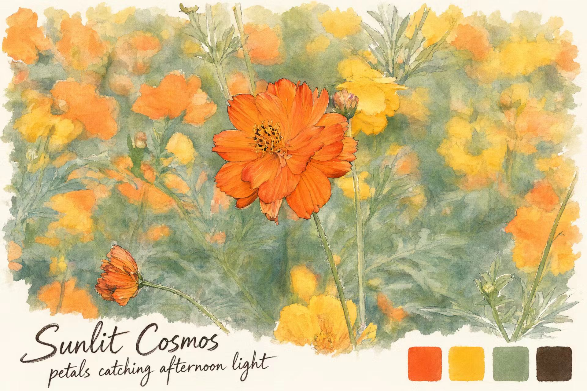

# Sunlit Cosmos · 案例图 / Example

## 案例说明

此图由用户提供，用于展示 `pen-watercolor-travel-journal-v1-0` 的视觉风格。画面以橙黄色花朵为主体，配有柔和的绿色背景、自然淡出的水彩边缘、英文手写题字与右下角四枚色卡。

- 标题：`Sunlit Cosmos`
- 短句：`petals catching afternoon light`
- 成品图片：[result.jpg](result.jpg)

本仓库未提供对应的原始照片。

## English

This user-supplied image illustrates the visual style of `pen-watercolor-travel-journal-v1-0`: orange and yellow flowers, a soft green background, fading watercolor edges, handwritten English lettering, and four swatches at the bottom right.

The corresponding source photo is not included.

[返回中文说明 / Chinese README](../../../README.md) · [English README](../../../README.en.md)
